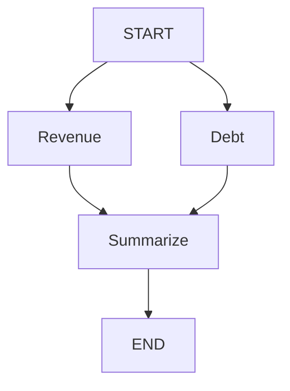

# Langgraph Crash Course

Code and brief notes from the topics covered in our discussion. Optional function annotations are omitted as requested; state-field annotations are retained.

## 1. Graph basics: state, nodes, and edges

LangGraph defines which functions run, in what order, and what data they share.

| Concept | Meaning |
| --- | --- |
| State | The data carried between steps. |
| Node | A function that reads state and returns updates. |
| Edge | A connection that determines which node runs next. |

### Install

```bash
python -m pip install langgraph
```

### Build and run a graph

This uses the corrected `create_prompt` name from our follow-up. The original example called that function and node `build_prompt`.

```python
from typing import TypedDict
from langgraph.graph import StateGraph, START, END

class State(TypedDict):
    question: str
    prompt: str

def clean_question(state):
    return {"question": state["question"].strip()}

def create_prompt(state):
    return {
        "prompt": f"Answer this financial question: {state['question']}"
    }

builder = StateGraph(State)
builder.add_node("clean_question", clean_question)
builder.add_node("create_prompt", create_prompt)

builder.add_edge(START, "clean_question")
builder.add_edge("clean_question", "create_prompt")
builder.add_edge("create_prompt", END)

graph = builder.compile()

result = graph.invoke({
    "question": "  What was revenue?  ",
    "prompt": "",
})

print(result)
```

Expected output:

```python
{
    "question": "What was revenue?",
    "prompt": "Answer this financial question: What was revenue?"
}
```

### Brief notes

- `StateGraph(State)` creates the builder using the state schema.
- `add_node()` registers a function under a node name; `add_edge()` defines the execution order.
- `compile()` creates the executable graph. It does not execute the nodes.
- `invoke()` supplies the initial state, runs the workflow, and returns its final state in this example.
- A node returns updates. Returning only `{"prompt": ...}` does not remove `question`.
- Without a custom reducer, an update replaces that field's previous value; omitted fields remain unchanged.
- `TypedDict` describes dictionary fields for type checking. It does not validate values at runtime or provide defaults.
- If `clean_question` returns `{}`, the next node receives the original question with spaces because no update was returned.

### Corrections discussed

- Remove `state: StateGraph` from the node functions. `StateGraph` is the builder; these functions receive a state dictionary.
- Correct the function spelling from `create_promt` to `create_prompt` so it matches the function registered with `add_node()`.
- Calling `State(...)` around the input dictionary is unnecessary. Pass the dictionary directly:

```python
result = graph.invoke({
    "question": " What is the revenue for FY2025  ",
    "prompt": ""
})

print(result)
```

## 2. Conditional routing

A normal edge always leads to the same node. A conditional edge calls a function that chooses the destination from the current state.

In our example, create a prompt only when the cleaned question contains text.

### Add the routing function

```python
def choose_next(state):
    if state["question"]:
        return "create_prompt"
    return END
```

- `"create_prompt"` means run that node.
- `END` means finish this workflow.
- A routing function returns a destination; the processing nodes return state-update dictionaries.
- Pass `choose_next` directly to `add_conditional_edges()`. It does not need `add_node()`.

### Replace the edge definitions and compile line

In the graph-building script from Topic 1, replace the three edge definitions and compile line with:

```python
builder.add_edge(START, "clean_question")
builder.add_conditional_edges("clean_question", choose_next)
builder.add_edge("create_prompt", END)

graph = builder.compile()
```

LangGraph runs `clean_question`, applies its update, and then calls `choose_next` with the updated state.

Remove this original unconditional edge from the script:

```python
builder.add_edge("clean_question", "create_prompt")
```

Keeping it would still schedule `create_prompt`, even when the routing function returns `END`.

### Whitespace input

```python
result = graph.invoke({"question": "   ", "prompt": ""})
print(result)
```

Output:

```python
{"question": "", "prompt": ""}
```

`clean_question` removes the spaces. The empty string makes the condition false, so `create_prompt` does not run.

## 3. Reducers: combining state updates

A reducer determines how a field's existing value and an incoming update are combined. Our example accumulates evidence from two successive nodes.

### Standalone example

```python
from typing import TypedDict, Annotated
from operator import add
from langgraph.graph import StateGraph, START, END

class State(TypedDict):
    evidence: Annotated[list[str], add]

def get_revenue(state):
    return {"evidence": ["Revenue grew 12%"]}

def get_debt(state):
    return {"evidence": ["Debt fell 5%"]}

builder = StateGraph(State)
builder.add_node("revenue", get_revenue)
builder.add_node("debt", get_debt)

builder.add_edge(START, "revenue")
builder.add_edge("revenue", "debt")
builder.add_edge("debt", END)

graph = builder.compile()
result = graph.invoke({"evidence": []})

print(result["evidence"])
```

Output:

```python
["Revenue grew 12%", "Debt fell 5%"]
```

### The reducer declaration

```python
evidence: Annotated[list[str], add]
```

- `list[str]`: the field contains a list of strings.
- `add`: combine the existing list and incoming list using `+`.
- `Annotated`: attaches that update rule to the field.
- This annotation affects LangGraph's behavior, so it is necessary for this example.

| Stage | `evidence` |
| --- | --- |
| Initially | `[]` |
| After `get_revenue` | `["Revenue grew 12%"]` |
| After `get_debt` | `["Revenue grew 12%", "Debt fell 5%"]` |

### Without the reducer

If the field were declared as:

```python
evidence: list[str]
```

The second node in this sequential example would replace the first node's evidence, leaving:

```python
["Debt fell 5%"]
```

### Brief notes

- With the `add` reducer, return only new items.
- Returning the existing list plus new items would duplicate the existing evidence when the reducer combines the lists.
- `add` concatenates lists; it does not deduplicate them.

## 4. Parallel execution: fan-out and fan-in

Revenue retrieval and debt retrieval can run concurrently because neither needs the other's result. A final node waits for both results.



### Standalone example

```python
from typing import TypedDict, Annotated
from operator import add
from langgraph.graph import StateGraph, START, END

class State(TypedDict):
    evidence: Annotated[list[str], add]
    summary: str

def get_revenue(state):
    return {"evidence": ["Revenue grew 12%"]}

def get_debt(state):
    return {"evidence": ["Debt fell 5%"]}

def summarize(state):
    return {"summary": "; ".join(state["evidence"])}

builder = StateGraph(State)
builder.add_node("revenue", get_revenue)
builder.add_node("debt", get_debt)
builder.add_node("summarize", summarize)

builder.add_edge(START, "revenue")
builder.add_edge(START, "debt")
builder.add_edge(["revenue", "debt"], "summarize")
builder.add_edge("summarize", END)

graph = builder.compile()

result = graph.invoke({"evidence": [], "summary": ""})
print(result["summary"])
```

The summary contains both facts.

### Three lines to understand

```python
builder.add_edge(START, "revenue")
builder.add_edge(START, "debt")
builder.add_edge(["revenue", "debt"], "summarize")
```

- The first two lines schedule both retrieval nodes in the same execution step: fan-out.
- The third line waits for both nodes to finish before running `summarize`: fan-in.
- If revenue takes one second and debt takes three seconds, `summarize` can start after approximately three seconds, plus overhead.

### State and reducers during parallel execution

- Both nodes receive the state from before the parallel step. `get_debt` cannot read the update being returned by `get_revenue` during that step.
- Both nodes update `evidence`, so the reducer combines their updates.
- Without that reducer, simultaneous updates to this field raise `InvalidUpdateError`.
- Parallel nodes writing different fields do not need a reducer merely because they run concurrently.

### Follow-up: why doesn't this cause a race condition?

LangGraph separates parallel node execution from applying state updates. The nodes return separate update dictionaries; they do not each append directly to one shared evidence list.

| When | What happens |
| --- | --- |
| Start | Both nodes read the initial `evidence: []`. |
| After 1 second | Revenue returns its update. LangGraph collects it. |
| After 3 seconds | Debt returns its update. Both nodes have finished. |
| Update phase | LangGraph combines the collected updates using the reducer. |
| Next step | `summarize` receives the combined evidence. |

Conceptually, the update phase does this. This snippet illustrates the runtime's merge process; `collected_updates` represents the updates returned by the nodes:

```python
evidence = []

for update in collected_updates:
    evidence = add(evidence, update["evidence"])
```

Each reducer call receives the accumulated result from the preceding call. The reducer specifies how to combine values; LangGraph's runtime controls when updates are applied.

Return updates from nodes:

```python
return {"evidence": ["Revenue grew 12%"]}
```

Avoid directly mutating the incoming state:

```python
state["evidence"].append("Revenue grew 12%")
```

Do not interpret the final list's order as the order in which nodes finished. This coordination applies to graph-state updates; shared global variables or external database writes still need their own concurrency handling.

## 5. MessagesState: user and assistant messages

`MessagesState` is a built-in state schema with a `messages` field. It already uses the `add_messages` reducer, so you do not need to define that field yourself.

### Standalone example

This example uses a fixed assistant reply.

```python
from langgraph.graph import StateGraph, MessagesState, START, END
from langchain_core.messages import HumanMessage, AIMessage

def reply(state):
    return {"messages": [AIMessage(content="Revenue grew 12%.")]}

builder = StateGraph(MessagesState)
builder.add_node("reply", reply)

builder.add_edge(START, "reply")
builder.add_edge("reply", END)

graph = builder.compile()

result = graph.invoke({
    "messages": [HumanMessage(content="How did revenue change?")]
})

for message in result["messages"]:
    print(message.type, message.content)
```

Output:

```text
human How did revenue change?
ai Revenue grew 12%.
```

### Three lines to understand

1. `StateGraph(MessagesState)` uses the predefined state containing the message list and its reducer.
2. `HumanMessage(content="...")` represents the user's message. `AIMessage` represents an assistant message; constructing one stores the supplied text.
3. `return {"messages": [AIMessage(...)]}` returns only the new assistant message. The reducer combines it with the existing user message.

To access the latest message's text:

```python
result["messages"][-1].content
```

This example does not automatically retain history between separate `invoke()` calls. That requires the persistence behavior discussed as a later topic.

### add_messages versus add

| Reducer | Behavior |
| --- | --- |
| `add` | Concatenates lists. |
| `add_messages` | Appends new messages, but replaces an existing message when the incoming message has the same ID. |

The message ID identifies whether an incoming message is new or an updated version of an existing message. Matching is by ID, not by text or meaning.

### Correct an existing message using the same ID

Start with a question and an answer:

```python
from langchain_core.messages import HumanMessage, AIMessage
from langgraph.graph.message import add_messages

messages = [
    HumanMessage(content="What was revenue?", id="q1"),
    AIMessage(content="Revenue was $10M.", id="a1")
]
```

Correct the answer while keeping its existing ID, `"a1"`:

```python
correction = AIMessage(
    content="Revenue was $12M.",
    id="a1"
)

messages = add_messages(messages, [correction])

print(len(messages))         # 2
print(messages[1].content)    # Revenue was $12M.
```

The existing answer is replaced in its original position. The question stays intact, and there are still two messages.

### A different ID appends a new message

Continuing from the corrected list:

```python
new_answer = AIMessage(
    content="Revenue was $15M.",
    id="a2"
)

messages = add_messages(messages, [new_answer])

print(len(messages))         # 3
```

Both answers now remain:

| ID | Content |
| --- | --- |
| `q1` | What was revenue? |
| `a1` | Revenue was $12M. |
| `a2` | Revenue was $15M. |

### Inside a graph

`MessagesState` applies this reducer automatically when a node returns:

```python
return {"messages": [correction]}
```

- Supply the existing message's ID when you intend to replace that message.
- A new conversational reply should have its own ID.
- The reducer does not decide whether two messages mean the same thing.

## 6. ToolNode and tools_condition: a graph-controlled tool loop

The LangGraph-specific behavior is how the graph routes between the model node and the tool node. The model and tool definitions are included to make the example standalone.

Requires `langgraph`, `langchain`, `langchain-openai`, and the `OPENAI_API_KEY` environment variable.

### Complete standalone example

```python
from langgraph.graph import StateGraph, MessagesState, START
from langchain.tools import tool, ToolNode
from langchain.tools.tool_node import tools_condition
from langchain_core.messages import HumanMessage
from langchain_openai import ChatOpenAI

@tool
def get_revenue(company: str, year: int):
    """Look up annual revenue in USD, or return None if unavailable."""
    data = {
        ("Acme", 2024): 100_000_000,
        ("Acme", 2025): 120_000_000
    }
    return data.get((company, year))

model = ChatOpenAI(model="gpt-5-nano")
model_with_tools = model.bind_tools([get_revenue])

def call_model(state):
    response = model_with_tools.invoke(state["messages"])
    return {"messages": [response]}

builder = StateGraph(MessagesState)

builder.add_node("model", call_model)
builder.add_node("tools", ToolNode([get_revenue]))

builder.add_edge(START, "model")
builder.add_conditional_edges("model", tools_condition)
builder.add_edge("tools", "model")

graph = builder.compile()

result = graph.invoke(
    {
        "messages": [
            HumanMessage(
                content="Use get_revenue to find Acme's revenue for 2025."
            )
        ]
    },
    config={"recursion_limit": 10}
)

print(result["messages"][-1].content)
```

### Three lines to understand

1. **`builder.add_node("tools", ToolNode([get_revenue]))`** registers the tool-execution node. It executes requested tool calls and returns their results as `ToolMessage` updates.
2. **`builder.add_conditional_edges("model", tools_condition)`** checks the last model message and chooses the next destination.
3. **`builder.add_edge("tools", "model")`** sends execution back to the model after the tool results have been added to state. This edge creates the cycle.

### Routing behavior

| Last model message contains | Destination |
| --- | --- |
| Tool calls | `"tools"` |
| No tool calls | `END` |

### Critical points

- `tools_condition` checks whether the latest model message already contains tool calls. It does not make another model call.
- The registered node name `"tools"` matches the destination returned by `tools_condition`.
- `ToolNode` executes the requested tool; the model node returns the model's message to state.
- `MessagesState` accumulates the messages through its reducer so later node executions can see the model's request and the tool's results.
- The edge from `"tools"` back to `"model"` gives the model another turn to use the tool result in its answer.
- `recursion_limit=10` bounds graph execution steps, not ten model calls or ten tool executions. Exhausting the limit without finishing raises `GraphRecursionError`.
- The `company: str` and `year: int` annotations define the tool's argument schema.

## 7. Checkpointing and threads

Without a checkpointer, separate `graph.invoke()` calls start with fresh state unless you pass history yourself. A checkpointer saves graph state, and a `thread_id` identifies which conversation's state to load on the next call.

### Complete standalone example

This example uses a fixed reply so we can focus on persistence. Requires `langgraph`; no model or API key is needed.

```python
from langgraph.graph import StateGraph, MessagesState, START, END
from langgraph.checkpoint.memory import InMemorySaver
from langchain_core.messages import HumanMessage, AIMessage

def reply(state):
    return {"messages": [AIMessage(content="Noted.")]}

builder = StateGraph(MessagesState)

builder.add_node("reply", reply)
builder.add_edge(START, "reply")
builder.add_edge("reply", END)

graph = builder.compile(checkpointer=InMemorySaver())

config = {"configurable": {"thread_id": "chat-1"}}

first = graph.invoke(
    {"messages": [HumanMessage(content="Review revenue.")]},
    config
)
print(len(first["messages"]))  # 2

second = graph.invoke(
    {"messages": [HumanMessage(content="Also review debt.")]},
    config
)
print(len(second["messages"]))  # 4

other = graph.invoke(
    {"messages": [HumanMessage(content="Review margins.")]},
    {"configurable": {"thread_id": "chat-2"}}
)
print(len(other["messages"]))  # 2
```

### Three lines to understand

1. `builder.compile(checkpointer=InMemorySaver())` attaches the checkpointer so graph state can be retained between calls.
2. `config = {"configurable": {"thread_id": "chat-1"}}` identifies the conversation whose state should be used.
3. `graph.invoke(..., config)` sends new input into that conversation. Reusing the same thread ID loads its saved state.

### Why those counts?

| Call | Thread | Previous messages | New messages | Total |
| --- | --- | ---: | --- | ---: |
| First | `chat-1` | 0 | User + reply | 2 |
| Second | `chat-1` | 2 | User + reply | 4 |
| Third | `chat-2` | 0 | User + reply | 2 |

### Critical points

- **Checkpointer retains state; the reducer merges updates.** They have different jobs.
- Send **only the new message** on subsequent calls. The checkpointer supplies previous state, and `MessagesState` merges the incoming messages.
- Return only the new reply from the node.
- **Thread ID identifies a conversation. Message ID identifies one message** within its history.
- A normal invocation with new input starts from `START`, using the thread's saved state.
- `InMemorySaver` holds checkpoints in RAM. Reuse the same graph/checkpointer instance; restarting the process loses that history.
- The fixed reply demonstrates retained message history. It does not demonstrate an LLM using that history to formulate its answer.

### FDE interview phrasing

"I use a thread ID to keep each conversation's workflow state separate, and a checkpointer to retain that state across calls."

## 8. Human approval with interrupt()

Pause a credit-report workflow, let an analyst approve it, then continue. This builds on checkpointing.

### Complete standalone example

Requires `langgraph`; no model or API key is needed.

```python
from typing import TypedDict
from langgraph.graph import StateGraph, START, END
from langgraph.checkpoint.memory import InMemorySaver
from langgraph.types import interrupt, Command

class State(TypedDict):
    report: str
    status: str

def review(state):
    approved = interrupt({
        "question": "Approve this report?",
        "report": state["report"]
    })
    return {"status": "approved" if approved else "rejected"}

builder = StateGraph(State)

builder.add_node("review", review)
builder.add_edge(START, "review")
builder.add_edge("review", END)

graph = builder.compile(checkpointer=InMemorySaver())

config = {"configurable": {"thread_id": "report-1"}}

paused = graph.invoke(
    {"report": "Acme revenue grew 12%.", "status": "pending"},
    config
)
print(paused["__interrupt__"][0].value)

# Simulate the analyst choosing Approve.
result = graph.invoke(Command(resume=True), config)

print(result["status"])  # approved
```

### Three things to understand

1. **`interrupt({...})`** pauses execution. The first `invoke()` returns with the approval request under `__interrupt__`.
2. **`paused["__interrupt__"][0].value`** contains the question and report your application can display.
3. **`Command(resume=True)`** supplies the decision. Inside `review`, the `interrupt(...)` call returns `True`, making `approved` true. Passing `False` produces `"rejected"` through the node's Python condition.

### How resume maps to approved or rejected

Follow these two lines in the example:

- **`approved = interrupt({...})`**: initially, execution pauses here. On resumption with `Command(resume=True)`, the node runs again and this `interrupt()` call returns `True`. That value is assigned to `approved`.
- **`return {"status": "approved" if approved else "rejected"}`**: ordinary Python chooses `"approved"` when `approved` is true, otherwise `"rejected"`.

| Resume call | Value assigned to `approved` | Returned status |
| --- | --- | --- |
| `Command(resume=True)` | `True` | `"approved"` |
| `Command(resume=False)` | `False` | `"rejected"` |

**Both calls resume execution.** The boolean carries the analyst's decision. LangGraph passes that value into `interrupt()`; our Python condition maps it to the status string.

### Critical points

- Use a checkpointer and resume with the **same thread ID** and the checkpointer holding that thread's saved state.
- **The interrupted node runs again from its beginning when resumed.** Any code before `interrupt()` executes again.
- Keep operations such as sending an email out of that section unless repeating them is safe.
- The first call returns the approval request to your application. The application displays it and collects the human's decision.
- The literal `True` in this example simulates that decision. In an application, the backend passes the UI's response to `Command(resume=...)`.
- `Command(resume=False)` continues the graph with a rejection decision.
- This example records a status in state; it does not publish or send the report.

## 9. Command: update state and choose the next node

A node can update state and choose the next node in the same return using `Command(update=..., goto=...)`. This combines the work previously split between a processing node and a conditional routing function.

### Complete standalone example

Here, the approval decision is already supplied in the input. Requires `langgraph`; no model or API key is needed.

```python
from typing import TypedDict
from langgraph.graph import StateGraph, START, END
from langgraph.types import Command

class State(TypedDict):
    approved: bool
    status: str

def route_decision(state):
    if state["approved"]:
        return Command(
            update={"status": "approved"},
            goto="finalize"
        )

    return Command(
        update={"status": "rejected"},
        goto=END
    )

def finalize(state):
    print("Finalizing report. Status:", state["status"])
    return {}

builder = StateGraph(State)

builder.add_node("route_decision", route_decision)
builder.add_node("finalize", finalize)

builder.add_edge(START, "route_decision")
builder.add_edge("finalize", END)

graph = builder.compile()

result = graph.invoke({"approved": True, "status": "pending"})
print(result["status"])  # approved
```

### Three things to understand

1. **`update={"status": "approved"}`** updates the state.
2. **`goto="finalize"`** schedules `finalize`, which receives the updated state.
3. **`goto=END`** ends this path after applying the rejection update.

### Routing behavior

| Input | State update | Next destination |
| --- | --- | --- |
| `approved=True` | `status="approved"` | `finalize` |
| `approved=False` | `status="rejected"` | `END` |

### Critical points

- Return `Command(update=..., goto=...)` from the node to combine state updates and routing.
- The destination node receives the updated state. In the example, `finalize` reads `status="approved"`.
- **Static outgoing edges still execute alongside Command routing.** Do not add an unconditional edge from `route_decision` to `finalize`; that would also run `finalize` for a rejection.
- `finalize` returns `{}`, so it leaves the state unchanged.
- This example only prints a message to demonstrate execution; it does not publish or send a report.
- Updating state and routing with `Command` alone requires neither a checkpointer nor a thread ID. Those were needed for the earlier pause/resume example.

### Keep the two Command uses separate

| Form | Where it goes | Purpose |
| --- | --- | --- |
| `Command(resume=...)` | Passed to `graph.invoke()` | Respond to an interrupt |
| `Command(update=..., goto=...)` | Returned from a node | Update state and route |


## 10. Streaming graph progress

`graph.stream()` lets you receive updates as nodes finish. With `stream_mode="updates"`, each event identifies the node and the state update it returned.

### Complete standalone example

```python
from typing import TypedDict
from langgraph.graph import StateGraph, START, END

class State(TypedDict):
    question: str
    prompt: str

def clean_question(state):
    return {"question": state["question"].strip()}

def create_prompt(state):
    return {
        "prompt": f"Answer this financial question: {state['question']}"
    }

builder = StateGraph(State)

builder.add_node("clean_question", clean_question)
builder.add_node("create_prompt", create_prompt)

builder.add_edge(START, "clean_question")
builder.add_edge("clean_question", "create_prompt")
builder.add_edge("create_prompt", END)

graph = builder.compile()

for update in graph.stream(
    {"question": "  What was revenue?  ", "prompt": ""},
    stream_mode="updates"
):
    print(update)
```

Output:

```text
{'clean_question': {'question': 'What was revenue?'}}
{'create_prompt': {'prompt': 'Answer this financial question: What was revenue?'}}
```

### What happens

1. `clean_question` finishes and you receive its update.
2. `create_prompt` finishes and you receive its update.
3. The graph reaches `END` and iteration finishes.

### Two modes to know

| Mode | What you receive |
| --- | --- |
| `"updates"` | Each node's name and the fields it returned |
| `"values"` | Full state snapshots: initial state and after each step |

Changing the example to `stream_mode="values"` produces three snapshots: initially, after cleaning, and after prompt creation.

### Critical points

- Iterating `graph.stream()` executes the graph. You do not need an `invoke()` first; doing both would execute the graph separately.
- An `"updates"` event contains the fields returned by that node.
- The final `"updates"` event contains only `prompt`. The graph still retains `question`.
- These events show completed nodes. They do not show progress inside a node that is still running.

**FDE use:** display workflow progress such as "Evidence retrieved" and "Draft prepared" while the remaining steps run.

## 11. Node retries with RetryPolicy

Attach a retry policy to a node so temporary failures trigger another attempt. This example simulates two API timeouts, followed by success. No API key is needed.

### Complete standalone example

```python
from itertools import count
from typing import TypedDict
from langgraph.graph import StateGraph, START, END
from langgraph.types import RetryPolicy

class State(TypedDict):
    revenue: int

attempts = count(1)  # Used only to simulate failures.

def fetch_revenue(state):
    attempt = next(attempts)
    print("Attempt:", attempt)

    if attempt < 3:
        raise TimeoutError("Revenue service timed out")

    return {"revenue": 120_000_000}

builder = StateGraph(State)

builder.add_node(
    "fetch_revenue",
    fetch_revenue,
    retry_policy=RetryPolicy(
        max_attempts=3,
        retry_on=TimeoutError
    )
)

builder.add_edge(START, "fetch_revenue")
builder.add_edge("fetch_revenue", END)

graph = builder.compile()

result = graph.invoke({"revenue": 0})
print(result["revenue"])
```

Output:

```text
Attempt: 1
Attempt: 2
Attempt: 3
120000000
```

### Three things to understand

1. **`retry_policy=...`** attaches retry behavior to this node.
2. **`max_attempts=3`** permits **one initial attempt plus two retries**.
3. **`retry_on=TimeoutError`** selects which exception triggers retries. The policy also supports delays between attempts.

### Critical points

- Each retry runs the **failing node from its beginning**. Previously completed nodes are not restarted by that retry.
- If the third attempt also fails, this example's `graph.invoke()` raises the exception.
- Returning an error dictionary counts as a normal return. **The node must raise an exception to trigger this policy.**
- External actions can repeat. A database write or email sent before the failure is not automatically undone.
- The counter is only demo machinery; a real API call would raise the exception when it fails.

## 12. Dynamic parallel execution with Send

A request might contain three companies today and twenty tomorrow. `Send` schedules one execution of the same node for each company, using a separate input for each execution.

### Complete standalone example

This example uses a mock review.

```python
from typing import TypedDict, Annotated
from operator import add
from langgraph.graph import StateGraph, START, END
from langgraph.types import Send

class State(TypedDict):
    companies: list[str]
    results: Annotated[list[str], add]

def dispatch(state):
    return [
        Send("review_company", {"company": company})
        for company in state["companies"]
    ]

def review_company(state):
    return {"results": [f"{state['company']}: reviewed"]}

builder = StateGraph(State)

builder.add_node("review_company", review_company)

builder.add_conditional_edges(START, dispatch)
builder.add_edge("review_company", END)

graph = builder.compile()

result = graph.invoke({
    "companies": ["Acme", "Globex", "Initech"],
    "results": []
})

print(sorted(result["results"]))
```

Output:

```text
['Acme: reviewed', 'Globex: reviewed', 'Initech: reviewed']
```

### Three things to understand

1. **`Send("review_company", {"company": company})`** specifies the node and the input for one execution.
2. **`dispatch` returns three `Send` objects**, scheduling three executions that can run concurrently.
3. **`Annotated[list[str], add]`** combines their returned lists into the graph's `results`.

### Critical points

- You register **one node** and execute it multiple times.
- Each worker receives its own payload, for example `{"company": "Acme"}`. That is why `company` does not need to appear in the overall `State` schema.
- Each worker returns only its own result. Concurrent writes to `results` require the reducer.
- One worker reaching `END` does not cancel the others. `invoke()` returns after the work finishes successfully.
- `sorted()` only makes the printed order predictable; it does not control execution order.

**FDE use:** process a variable number of documents or companies concurrently and collect their results.

## 13. Debugging with get_state()

Inspect what state was saved and which node is pending. This example reuses the approval workflow.

### Complete standalone example

```python
from typing import TypedDict
from langgraph.graph import StateGraph, START, END
from langgraph.checkpoint.memory import InMemorySaver
from langgraph.types import interrupt, Command

class State(TypedDict):
    report: str
    status: str

def review(state):
    approved = interrupt("Approve this report?")
    return {"status": "approved" if approved else "rejected"}

builder = StateGraph(State)

builder.add_node("review", review)
builder.add_edge(START, "review")
builder.add_edge("review", END)

graph = builder.compile(checkpointer=InMemorySaver())
config = {"configurable": {"thread_id": "report-1"}}

graph.invoke(
    {"report": "Revenue grew 12%.", "status": "pending"},
    config
)

snapshot = graph.get_state(config)

print(snapshot.values)
print(snapshot.next)

graph.invoke(Command(resume=True), config)

snapshot = graph.get_state(config)

print(snapshot.values["status"])
print(snapshot.next)
```

Output:

```text
{'report': 'Revenue grew 12%.', 'status': 'pending'}
('review',)
approved
()
```

### Two fields to understand

| Field | Meaning |
| --- | --- |
| `snapshot.values` | Saved graph-state dictionary |
| `snapshot.next` | Tuple of node names scheduled to execute next |

Before approval, `review` is still pending. After approval, `status` becomes `"approved"` and no nodes remain scheduled.

### Critical points

- `get_state()` **reads saved state**; it does not run or resume the graph.
- Use the same thread ID and the checkpointer holding its state.
- Call `get_state()` again after execution changes: the earlier snapshot does not refresh automatically.
- `next=()` means no pending nodes. Check the state to determine the business outcome: a rejected report can also finish with `next=()`.

For debugging, the first questions are: **"Did the expected data reach state?" and "Which node is pending?"**

## 14. Debugging with get_state_history()

`get_state()` showed the latest saved state. `get_state_history()` lets you inspect earlier checkpoints and trace how a value changed.

### Complete standalone example

```python
from typing import TypedDict
from langgraph.graph import StateGraph, START, END
from langgraph.checkpoint.memory import InMemorySaver

class State(TypedDict):
    value: int

def add_one(state):
    return {"value": state["value"] + 1}

def double(state):
    return {"value": state["value"] * 2}

builder = StateGraph(State)

builder.add_node("add_one", add_one)
builder.add_node("double", double)

builder.add_edge(START, "add_one")
builder.add_edge("add_one", "double")
builder.add_edge("double", END)

graph = builder.compile(checkpointer=InMemorySaver())
config = {"configurable": {"thread_id": "debug-1"}}

graph.invoke({"value": 3}, config)

for snapshot in graph.get_state_history(config):
    print(snapshot.values, snapshot.next)
```

Output, **newest first**:

```text
{'value': 8} ()
{'value': 4} ('double',)
{'value': 3} ('add_one',)
{} ('__start__',)
```

### How to read it

| Saved value | What was scheduled next | Meaning |
| --- | --- | --- |
| `8` | Nothing | `double` finished |
| `4` | `double` | `add_one` finished |
| `3` | `add_one` | Initial input was applied |
| Empty state | `__start__` | Before applying the input |

### Critical points

- History comes **newest first**.
- `snapshot.next` identifies what would execute **after that checkpoint**. At value `4`, it names `double` because `add_one` already finished.
- Reading history **does not rerun any nodes**.
- These are saved graph checkpoints, not snapshots of every Python statement or local variable.

In a real workflow, this helps locate where incorrect data first appeared, for example during retrieval, analysis, or final formatting.
