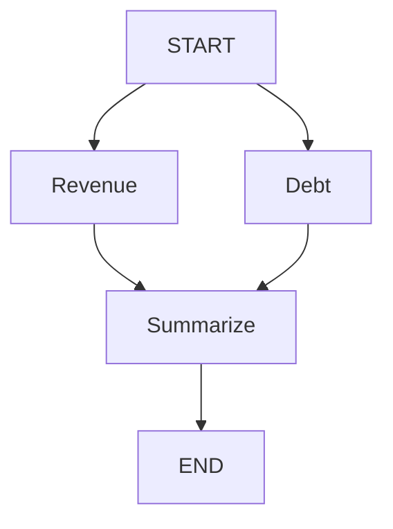

# Langgraph Crash Course

Code and brief notes from the four topics covered in our discussion. Optional function annotations are omitted as requested; state-field annotations are retained.

## 1. Graph basics: state, nodes, and edges

LangGraph defines which functions run, in what order, and what data they share.

| Concept | Meaning |
| --- | --- |
| State | The data carried between steps. |
| Node | A function that reads state and returns updates. |
| Edge | A connection that determines which node runs next. |

### Install

```bash
python -m pip install langgraph
```

### Build and run a graph

This uses the corrected `create_prompt` name from our follow-up. The original example called that function and node `build_prompt`.

```python
from typing import TypedDict
from langgraph.graph import StateGraph, START, END

class State(TypedDict):
    question: str
    prompt: str

def clean_question(state):
    return {"question": state["question"].strip()}

def create_prompt(state):
    return {
        "prompt": f"Answer this financial question: {state['question']}"
    }

builder = StateGraph(State)
builder.add_node("clean_question", clean_question)
builder.add_node("create_prompt", create_prompt)

builder.add_edge(START, "clean_question")
builder.add_edge("clean_question", "create_prompt")
builder.add_edge("create_prompt", END)

graph = builder.compile()

result = graph.invoke({
    "question": "  What was revenue?  ",
    "prompt": "",
})

print(result)
```

Expected output:

```python
{
    "question": "What was revenue?",
    "prompt": "Answer this financial question: What was revenue?"
}
```

### Brief notes

- `StateGraph(State)` creates the builder using the state schema.
- `add_node()` registers a function under a node name; `add_edge()` defines the execution order.
- `compile()` creates the executable graph. It does not execute the nodes.
- `invoke()` supplies the initial state, runs the workflow, and returns its final state in this example.
- A node returns updates. Returning only `{"prompt": ...}` does not remove `question`.
- Without a custom reducer, an update replaces that field's previous value; omitted fields remain unchanged.
- `TypedDict` describes dictionary fields for type checking. It does not validate values at runtime or provide defaults.
- If `clean_question` returns `{}`, the next node receives the original question with spaces because no update was returned.

### Corrections discussed

- Remove `state: StateGraph` from the node functions. `StateGraph` is the builder; these functions receive a state dictionary.
- Correct the function spelling from `create_promt` to `create_prompt` so it matches the function registered with `add_node()`.
- Calling `State(...)` around the input dictionary is unnecessary. Pass the dictionary directly:

```python
result = graph.invoke({
    "question": " What is the revenue for FY2025  ",
    "prompt": ""
})

print(result)
```

## 2. Conditional routing

A normal edge always leads to the same node. A conditional edge calls a function that chooses the destination from the current state.

In our example, create a prompt only when the cleaned question contains text.

### Add the routing function

```python
def choose_next(state):
    if state["question"]:
        return "create_prompt"
    return END
```

- `"create_prompt"` means run that node.
- `END` means finish this workflow.
- A routing function returns a destination; the processing nodes return state-update dictionaries.
- Pass `choose_next` directly to `add_conditional_edges()`. It does not need `add_node()`.

### Replace the edge definitions and compile line

In the graph-building script from Topic 1, replace the three edge definitions and compile line with:

```python
builder.add_edge(START, "clean_question")
builder.add_conditional_edges("clean_question", choose_next)
builder.add_edge("create_prompt", END)

graph = builder.compile()
```

LangGraph runs `clean_question`, applies its update, and then calls `choose_next` with the updated state.

Remove this original unconditional edge from the script:

```python
builder.add_edge("clean_question", "create_prompt")
```

Keeping it would still schedule `create_prompt`, even when the routing function returns `END`.

### Whitespace input

```python
result = graph.invoke({"question": "   ", "prompt": ""})
print(result)
```

Output:

```python
{"question": "", "prompt": ""}
```

`clean_question` removes the spaces. The empty string makes the condition false, so `create_prompt` does not run.

## 3. Reducers: combining state updates

A reducer determines how a field's existing value and an incoming update are combined. Our example accumulates evidence from two successive nodes.

### Standalone example

```python
from typing import TypedDict, Annotated
from operator import add
from langgraph.graph import StateGraph, START, END

class State(TypedDict):
    evidence: Annotated[list[str], add]

def get_revenue(state):
    return {"evidence": ["Revenue grew 12%"]}

def get_debt(state):
    return {"evidence": ["Debt fell 5%"]}

builder = StateGraph(State)
builder.add_node("revenue", get_revenue)
builder.add_node("debt", get_debt)

builder.add_edge(START, "revenue")
builder.add_edge("revenue", "debt")
builder.add_edge("debt", END)

graph = builder.compile()
result = graph.invoke({"evidence": []})

print(result["evidence"])
```

Output:

```python
["Revenue grew 12%", "Debt fell 5%"]
```

### The reducer declaration

```python
evidence: Annotated[list[str], add]
```

- `list[str]`: the field contains a list of strings.
- `add`: combine the existing list and incoming list using `+`.
- `Annotated`: attaches that update rule to the field.
- This annotation affects LangGraph's behavior, so it is necessary for this example.

| Stage | `evidence` |
| --- | --- |
| Initially | `[]` |
| After `get_revenue` | `["Revenue grew 12%"]` |
| After `get_debt` | `["Revenue grew 12%", "Debt fell 5%"]` |

### Without the reducer

If the field were declared as:

```python
evidence: list[str]
```

The second node in this sequential example would replace the first node's evidence, leaving:

```python
["Debt fell 5%"]
```

### Brief notes

- With the `add` reducer, return only new items.
- Returning the existing list plus new items would duplicate the existing evidence when the reducer combines the lists.
- `add` concatenates lists; it does not deduplicate them.

## 4. Parallel execution: fan-out and fan-in

Revenue retrieval and debt retrieval can run concurrently because neither needs the other's result. A final node waits for both results.



### Standalone example

```python
from typing import TypedDict, Annotated
from operator import add
from langgraph.graph import StateGraph, START, END

class State(TypedDict):
    evidence: Annotated[list[str], add]
    summary: str

def get_revenue(state):
    return {"evidence": ["Revenue grew 12%"]}

def get_debt(state):
    return {"evidence": ["Debt fell 5%"]}

def summarize(state):
    return {"summary": "; ".join(state["evidence"])}

builder = StateGraph(State)
builder.add_node("revenue", get_revenue)
builder.add_node("debt", get_debt)
builder.add_node("summarize", summarize)

builder.add_edge(START, "revenue")
builder.add_edge(START, "debt")
builder.add_edge(["revenue", "debt"], "summarize")
builder.add_edge("summarize", END)

graph = builder.compile()

result = graph.invoke({"evidence": [], "summary": ""})
print(result["summary"])
```

The summary contains both facts.

### Three lines to understand

```python
builder.add_edge(START, "revenue")
builder.add_edge(START, "debt")
builder.add_edge(["revenue", "debt"], "summarize")
```

- The first two lines schedule both retrieval nodes in the same execution step: fan-out.
- The third line waits for both nodes to finish before running `summarize`: fan-in.
- If revenue takes one second and debt takes three seconds, `summarize` can start after approximately three seconds, plus overhead.

### State and reducers during parallel execution

- Both nodes receive the state from before the parallel step. `get_debt` cannot read the update being returned by `get_revenue` during that step.
- Both nodes update `evidence`, so the reducer combines their updates.
- Without that reducer, simultaneous updates to this field raise `InvalidUpdateError`.
- Parallel nodes writing different fields do not need a reducer merely because they run concurrently.

### Follow-up: why doesn't this cause a race condition?

LangGraph separates parallel node execution from applying state updates. The nodes return separate update dictionaries; they do not each append directly to one shared evidence list.

| When | What happens |
| --- | --- |
| Start | Both nodes read the initial `evidence: []`. |
| After 1 second | Revenue returns its update. LangGraph collects it. |
| After 3 seconds | Debt returns its update. Both nodes have finished. |
| Update phase | LangGraph combines the collected updates using the reducer. |
| Next step | `summarize` receives the combined evidence. |

Conceptually, the update phase does this. This snippet illustrates the runtime's merge process; `collected_updates` represents the updates returned by the nodes:

```python
evidence = []

for update in collected_updates:
    evidence = add(evidence, update["evidence"])
```

Each reducer call receives the accumulated result from the preceding call. The reducer specifies how to combine values; LangGraph's runtime controls when updates are applied.

Return updates from nodes:

```python
return {"evidence": ["Revenue grew 12%"]}
```

Avoid directly mutating the incoming state:

```python
state["evidence"].append("Revenue grew 12%")
```

Do not interpret the final list's order as the order in which nodes finished. This coordination applies to graph-state updates; shared global variables or external database writes still need their own concurrency handling.
