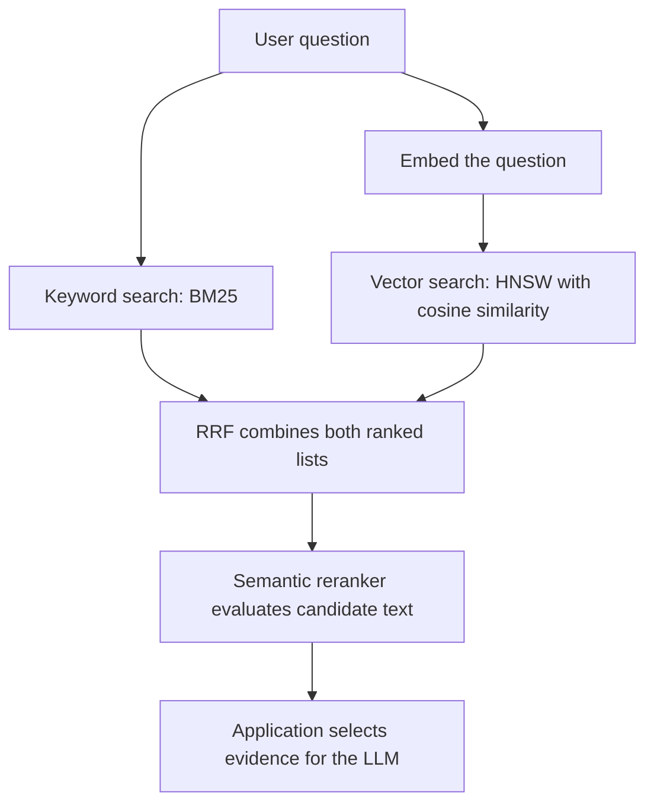

# Conversational Financial Chatbot — Mock Interview Q&A

Questions asked so far, paired with ythe posted answers and clarifications. Ythe wording is preserved, with Markdown formatting added for readability. Changes of direction and unanswered questions are marked.

## 1. Request flow and personal ownership

**Question**
I prepared a simplified diagram to make the chatbot’s request flow and the parts I personally owned easier to follow. It uses generic components and no customer data. May I share my screen and use it as a visual reference

For “Compare Amzaon’s FY2025 revenue with FY2024 and explain the change,” can you walk me through a single request from API entry to final response, identifying the main components and what you personally designed and implemented?

**the answer**

“The request enters the FastAPI backend, where the application establishes the authorized company/CAR/version scope and identifies the conversation.

`make_conversation_config()` creates a unique `thread_id` for a new conversation or reuses the saved ID for a continued or reopened conversation. We pass it in the graph’s invocation configuration. The graph is compiled with a checkpointer, which restores the persisted `AgentState` for that thread. The new request is supplied without overwriting its retained conversation memory.

`plan()` then checks that memory matches the request’s trusted scope and retains only validated, matching tool results. It clears the previous turn’s working `handoff`, `results` and `workflow`, and resets execution counters.

It invokes the LLM with the `Analysis` schema to interpret the question using that memory, extracting the topic, measures and periods. Python stores the validated interpretation in `request["analysis"]`.

`supervisor()` makes a separate structured LLM call returning `RoutingDecision`. For this question, it selects `both`; Orchestrator routes execution to SQL first.`sql()` constructs the scoped comparison arguments and calls `sql_metrics` (MCP) through `invoke_tool()`. That wrapper enforces argument checks, call limits, timeouts and bounded retries, then validates the response and invokes the SQL business guard.

The accepted result is stored in `results["SQL"]`. `semantic()` reads those findings, adds them to the explanation query and passes them as `numeric_findings` to `semantic_evidence` MCP.

`answer()` synthesizes the numerical and document evidence into a cited response. Production factual and reasoning checks validate the draft before return. `update_memory()` retains useful validated tool results and the last three Q/A pairs, and checkpointing persists the state.

My main hands-on contribution was the shared state and conversation-control layer. 
#1:I defined AgentState, which provides the communication contract between nodes;
#2: implemented plan() to interpret the request using scoped conversation context.
#3: implemented the supervisor() node’s structured route selection 
#4: invoke_tool():checks tool arguments, enforces call limits and timeouts, retries transient failures, validates the response, and returns either accepted results or a structured failure with updated execution counter
#5: update_memory() to retain validated results and recent conversation history. 
#6: I integrated checkpoint persistence so the workflow’s state could be stored and restored using the conversation’s thread ID.

To make the shared-state design more concrete, this second illustration shows the contracts I defined and how each node populates or consumes them

## Q2 — What does the conversation state look like immediately after this response? Which fields does the application control, and which can the LLM update?

`AgentState` has six sections.

`request` contains the original question, the trusted company/CAR/version scope, and the resolved analysis—for example, revenue for FY2024 and FY2025. The 
LLM proposes the analysis; Python validates it through the `Analysis` schema and stores it in `request["analysis"]`.

`results` contains the tool outcomes. On a successful run, `sql()` stores the validated financial comparison—values, periods, units, calculated changes and sthece references—in `results["SQL"]`. Then `semantic()` reads `results["SQL"]["findings"]` to target its explanation search and stores the validated document evidence and citations in `results["Evidence"]`.

`handoff` records the latest specialist and its arguments. After the explanation search, that is the Evidence specialist. The earlier SQL findings remain in `results`.

`workflow` contains the selected route—`both` in this example—and the final answer in `workflow["output"]["final_answer"]`. The LLM proposes the route through the `RoutingDecision` schema and generates the answer text; Python writes both into state.

`execution_control` contains the application’s limits and actual usage—for example, two tool calls and zero retries for a successful SQL-plus-evidence response.

Finally, `context_memory` retains useful validated tool results and up to three recent question-and-answer pairs for follow-ups. Recent conversation text helps interpret the next question; it is not treated as verified financial evidence.

The application controls trusted scope, tool arguments, counters, validation flags and memory retention. The LLM proposes the analysis, route and answer; it does not directly mutate the state. The conversation’s `thread_id` is passed separately in the invocation configuration so the checkpointer can restore the correct conversation.”


## 3. Resolving an ambiguous follow-up

**Question**

The user’s next message is “What about margins?” How does ythe implemented system resolve that follow-up from stored state and decide whether to execute a tool or ask for clarification?

**Answer**

“The application first identifies the conversation. `make_conversation_config()` reuses its saved `thread_id` for a follow-up or reopened conversation. Starting a new conversation creates a new ID, even for the same user and CAR.

With the same thread ID, the checkpointer restores the previous state. We submit the new `request` without overwriting `context_memory`.

`plan()` checks that memory matches the trusted company/CAR/version scope and filters out unvalidated stored results. It then passes the request, recent messages and validated results to the LLM to produce a fresh `Analysis`.

For ‘What about margins?’, it can recover FY2024 and FY2025 from the previous exchange. But unless the context identifies gross, operating or net margin, the planner is instructed to leave `measures=[]`. That interpretation is stored in `request["analysis"]`.

`supervisor()` is instructed to select `answer` when necessary inputs are missing. `choose_next_node()` follows that route, and `answer()` asks which margin the user means. If SQL is selected despite empty measures, `guard_arguments()` blocks the MCP call.

`update_memory()` saves that clarification exchange while preserving earlier validated results. When the user replies ‘operating margin’, the next `plan()` call can combine that clarification with the established periods.

The supervisor then assesses whether validated memory already supports the comparison. Otherwise, `sql()` constructs the scoped comparison request. If an explanation is also required, the `both` route runs SQL before semantic retrieval.

In a new conversation, there are no previous periods to inherit, so those may need clarification too.”

## 4. Enforcing authorized company scope

**Question**

If a tool request attempts to use Company B while the application has established Company A as the authorized scope, which check blocks it, and when does that run?

**Answer**

“The application supplies the trusted scope in `request["scope"]`. The planner’s `Analysis` schema does not include company scope, and the specialist nodes construct tool arguments using that trusted request scope.

The concrete enforcement point is `guard_arguments()`, called at the start of `invoke_tool()`. It checks:

`arguments["scope"] != state["request"]["scope"]`

If the tool arguments contain Company B while the trusted request contains Company A, it raises `ValueError("Wrong scope")`.

That happens before the retry loop, before incrementing the tool-call counter, and before `session.call_tool()`. The wrapper catches the exception and returns a blocked result with `validated=False` and the failure reason. No MCP request or retry occurs.

Pydantic validates structure; this Python check enforces the trusted scope boundary. The application must establish that trusted scope from the user’s authorization before invoking the graph.”

## 5. From a routing decision to an executable MCP call

**Question**

For the original Company A request, how does ythe implementation turn the supervisor’s routing decision into an executable SQL MCP call? Show small JSON examples of the supervisor output and final tool arguments, identifying which component constructs the arguments.

**Answer**

“`supervisor()` invokes the LLM with the `RoutingDecision` schema. For a question requiring figures and explanations, its output is:

```json
{"route": "both"}
```

Python stores that in `workflow["route"]`. `choose_next_node()` maps `both` to `sql`, so the financial comparison runs first.

The `sql()` node constructs the arguments. It takes measures and periods from `request["analysis"]`, copies the application-controlled `request["scope"]`, and sets `operation="compare"`:

```json
{
  "scope": {
    "company_id": "company-a",
    "car_id": "CAR-101",
    "version": "v1"
  },
  "measures": ["revenue"],
  "periods": ["FY2024", "FY2025"],
  "operation": "compare"
}
```

It passes those arguments to:

`invoke_tool(state, "sql_metrics", arguments)`

The wrapper checks the tool name, scope and required arguments before execution. It then enforces the call budget and timeout around `session.call_tool()`, applies the retry policy, and validates the returned result.

The MCP SQL specialist owns translating the structured request into SQL and executing it. The supervisor chooses the route; `sql()` constructs the MCP arguments; the server performs the financial query.

For the `both` route, accepted SQL findings subsequently inform the arguments constructed by `semantic()`.”

## 6. A concrete SQL MCP argument object

**Question**

What tool name and JSON argument object does `invoke_tool()` receive for Company A’s FY2025 versus FY2024 revenue comparison?

**Answer**

“The tool name is `sql_metrics`, and a representative argument object is:

```json
{
  "scope": {
    "company_id": "company-a",
    "car_id": "CAR-101",
    "version": "v1"
  },
  "measures": ["revenue"],
  "periods": ["FY2024", "FY2025"],
  "operation": "compare"
}
```

The `sql()` node constructs this object from the resolved measures and periods in `request["analysis"]`, copies the trusted `request["scope"]`, and sets the comparison operation.
It calls `invoke_tool(state, "sql_metrics", arguments)`. After checking the arguments, the wrapper dispatches the MCP call. The SQL specialist on the server translates the structured request into SQL and executes it.


## Q7 — SQL-to-semantic execution sequence and handoff

**Question**

With `route="both"`, what execution sequence does ythe graph follow, and what information from the accepted SQL result goes into the semantic request?

**Answer**

“`choose_next_node()` maps `both` to `sql`, so SQL runs first. The explanation search depends on the financial findings.

`sql()` calls `sql_metrics` through `invoke_tool()`, which validates the response before marking it accepted. The node stores the outcome in `results["SQL"]`.

`choose_after_sql()` then checks its status. It continues to `semantic` only for `ok` or `partial`; otherwise, it routes to `answer` to report the available evidence and gaps.

Inside `semantic()`, Python reads `results["SQL"]["findings"]` and constructs the next request:

- `scope` comes from the trusted request.
- `periods` come from the SQL result, and `measures` are extracted from its findings.
- `numeric_findings` carries the complete findings, including the accepted values, calculated changes, units and sthece references.
- `query` starts with the original question and appends ‘Find documented explanations for:’ followed by those serialized findings.

The request also specifies the three permitted sthece collections and `top_k=5`, then calls `invoke_tool()` with `semantic_evidence`.

For example, the accepted revenue comparison establishes an increase from USD 11.8 billion to USD 12.4 billion—USD 600 million, or 5.08%. Those findings guide the search for the documented revenue drivers.

The returned evidence is validated and stored in `results["Evidence"]`, alongside the SQL result. `answer()` uses both. In production, the final draft also passes factual and reasoning checks. If the explanation remains unsupported, we return the supported comparison with an explicit explanation gap.”

## 8. Short implementation exercise: revenue comparison

**Question**

Each revenue record has `company_id`, `fiscal_year`, `value`, `currency`, and `unit`. SQL returns:

- FY2025: `12.4 USD billion`
- FY2024: `11_800 USD million`

Can you write a small Python function or pseudocode that returns percentage growth, including validation for records that cannot safely be compared?

**Ythe answer**

Valuation check - reject wrong currency , any other year, any other scope from existing state

Normalize units

Calculate % change

This is called after the guards

## Q9 — Guard ordering and calculation

**Question**

When you say this runs “after the guards,” which guards have already run, and what exactly have they validated before units are normalized and growth is calculated?

**Answer**

“I distinguish input validation, calculation verification and final-answer validation.

Before MCP execution, `guard_arguments()` checks the permitted tool, trusted scope, required measures, two comparison periods and comparison operation.

Before the financial helper calculates anything, its input checks establish that both records represent the requested company, measure and periods. Values must be finite, currency and scale must be present and supported, and sthece references must identify the underlying records. The records must also be comparable—for example, full-year consolidated revenue should not be compared with quarterly or segment revenue.

Passing those checks makes the records eligible for calculation. The helper converts supported scales into common units using `Decimal`, rejects currency mismatches and handles a zero baseline explicitly.

For example, USD 12.4 billion and USD 11,800 million become 12,400 and 11,800 million. The helper calculates a 600-million increase and approximately 5.08% growth, retaining precision until display rounding.

The completed comparison then passes arithmetic verification. In the orchestrator, `validate_result()` checks the returned schema, scope and periods, and `guard_sql()` verifies the financial findings, arithmetic and record references. Only after that succeeds does `invoke_tool()` assign `validated=True`.

After drafting, factual checks compare numerical claims and citations with the accepted evidence. Reasoning checks assess whether the answer satisfies the requested comparison and supports its explanations. A supported revenue increase does not, by itself, establish why revenue increased.”

## 11. Invoking the LLM

**Question**

How do you invoke the LLM in ythe chatbot? Walk me through one actual call, including what you send and what ythe code receives.

**Ythe answer**

~~~python
llm = ChatOpenAI(model=MODEL_NAME)
router = llm.with_structured_output(Decision)

decision = router.invoke([
    ("system", "Choose sql, semantic, both, or final. "
               "Use both when numbers and explanations are required."),
    ("human", "Authorized scope: Company A, CAR_A. "
              "Compare FY2025 revenue with FY2024 and explain the change.")
])
~~~

LangChain populates Decision object in return with both and query string

## Q18 — Tool failures

**Question**

SQL succeeds, but semantic retrieval times out. What happens next, including retries and the response returned to the user?

**Answer**

“The validated SQL comparison remains in `results["SQL"]`. Retrying semantic retrieval does not rerun SQL.

Inside `invoke_tool()`, `asyncio.wait_for()` applies the per-attempt timeout. With the replica’s defaults, each attempt has ten seconds and one additional retry is allowed. After the first timeout, the wrapper waits 0.25 seconds, checks the shared tool-call budget again, and retries only `semantic_evidence`.

If the retry succeeds, its response still passes `validate_result()` and `guard_evidence()` before being accepted.

If it also times out, `tool_failure()` returns `status="error"`, `validated=False`, empty findings and `gaps=["Retries exhausted"]`. It also records that stop reason.

`semantic()` stores this outcome in `results["Evidence"]` while preserving the SQL result. The graph then proceeds directly to `answer()`.

Assuming no relevant explanation is already available in validated memory, the response gives the supported financial comparison and states that the explanation could not be verified. For example:

> Revenue increased from USD 11.8 billion in FY2024 to USD 12.4 billion in FY2025, approximately 5.08%, based on the cited financial records. Document retrieval failed after retrying, so I couldn’t verify the reasons for the increase.

A failed lookup is distinguished from a successful lookup returning `status="empty"`. Neither justifies inventing a cause.

If SQL succeeded on its first attempt, this scenario records three tool calls and one retry.”

## Q19 — Recovery after a worker restart

**Question:** The worker restarts after SQL completes. What was persisted, and which operations execute again?

**Answer:**

We persisted LangGraph checkpoints in Cosmos DB and used synchronous durability (`durability="sync"`), so each checkpoint was committed before the next graph step started.

After the SQL node completed, the persisted state included:

- The resolved question and company/CAR scope.
- Validated SQL results with periods, currencies, units and sthece references.
- Tool-budget counters and the original request deadline.
- LangGraph’s execution position identifying the pending next step.

On restart, the worker recovered the existing job and resumed the same LangGraph thread from its latest checkpoint.

**If the SQL result had been checkpointed, SQL and its earlier query-generation calls didn’t run again.** The workflow continued with the pending supervisor or semantic step, followed by validation and answer generation. The restart didn’t reset the budget or deadline.

One important failure window remains: if SQL returned but the worker crashed before its result was durably recorded, the SQL node could execute again.

**Synchronous durability doesn’t make the external SQL call and the checkpoint a single atomic transaction.**

the SQL operation was read-only, so replay wouldn’t duplicate database writes. Operations that create or publish results still needed idempotency protection.

## Q20 — A citation exists but does not support the claim

**Question**

A cited passage exists but doesn’t support the answer’s claim. How does ythe implementation detect and handle that?

**Answer**

“We distinguish a valid citation reference from a supported claim, and check support at two points.

Before drafting, `validate_result()` checks the tool response’s schema, scope and reporting periods. The `guard_evidence()` business check then verifies permitted stheces, cited passages and support for the returned explanation.

For example, a table showing a USD 600-million revenue increase supports the comparison. It does not establish that an acquisition caused it.

If evidence validation fails, `invoke_tool()` returns a blocked result with `validated=False`, empty findings and the failure reason. This is a validation failure, so it is not retried. `semantic()` stores that outcome in `results["Evidence"]` while preserving the accepted SQL result.

The graph then proceeds to `answer()`, which is instructed to exclude rejected findings and report explanation gaps.

A second check is necessary because the answer generator could introduce an unsupported inference even from valid evidence. In production, the post-draft factual guard checks the answer’s individual claims against their cited records or passages. Numerical claims are checked against accepted financial results; explanations require evidence supporting the stated relationship.

An unsupported explanation cannot be accepted simply because its citation exists. The supported comparison can still be returned with the explanation identified as unresolved.

LLM-based support judgments remain fallible; a schema-valid guard response alone does not establish factual correctness.”

## Q21 — Debugging and ownership

**Question:** Describe one failure you personally debugged—the symptom, root cause, code change, and evidence that the fix worked.

**Answer:**

During testing of the CAR chatbot, a revenue comparison showed an approximately **99.9% decline**, even though the financial records showed an increase.

### The symptom

FY2025 revenue was **12.4 USD billion**, and FY2024 revenue was **11,800 USD million**. The retrieved values, company and reporting periods were correct, and the citations pointed to the right records.

### How I isolated the root cause

I followed the request’s trace from the SQL tool response into the calculation helper. I reproduced the problem using those two records, without invoking the LLM.

The helper received bare numeric values and calculated:

```text
(12.4 - 11800) / 11800 × 100
```

The schema checks passed because both records were individually valid. The missing step was normalizing their units before comparing them.

### My code change

I changed the helper’s interface to accept the financial records, including their currency and unit metadata, rather than just two numbers. It validated comparability, converted supported units into a common scale using Decimal arithmetic, and then calculated growth.

Missing or unsupported units and currency mismatches produced explicit validation errors.

For this example, the normalized values became **12,400 and 11,800 USD million**, producing **5.08% growth**.

### Evidence that the fix worked

I kept the original pair as a regression fixture: it reproduced the incorrect decline before the change and returned the expected 5.08% afterwards.

I also checked that expressing both values in millions or both in billions produced the same result. Separate cases verified that missing units, mismatched currencies and a zero baseline were handled explicitly.

I then replayed the original question through the full workflow and checked the displayed figures, growth calculation and sthece references together. That verified that the corrected helper result reached the user’s answer.

## 12. Search index, hybrid retrieval, and evidence selection

**Question**

How did you create and populate the search index, retrieve relevant passages, and select evidence for the LLM?

**Answer**

The ingestion pipeline was:

Documents → Azure Document Intelligence → structured text/tables → hierarchical parent–child chunks → `text-embedding-3-small` embeddings → Azure AI Search.

I defined the index using `SearchIndexClient`. Each record represents one child chunk and stores its ID, text, embedding, parent-section ID, and metadata such as company/document identifiers, section header, and page numbers. The ingestion pipeline uploads these records.

The text field is searchable for keyword retrieval, company/document identifiers are filterable, and the embedding field supports vector retrieval using **HNSW with cosine similarity**. Its dimensions match the embedding model’s output—1,536 with our default `text-embedding-3-small` configuration.

**Text and embeddings represent the same chunk.** A hybrid request searches both representations in parallel, then combines their rankings:



The stages have different responsibilities:

1. **Keyword retrieval:** Searches the text fields for matching query terms and ranks chunks using **BM25**.

2. **Vector retrieval:** Embeds the question using the same model used during ingestion. **HNSW** finds nearby chunk vectors using **cosine similarity**, which compares vector directions. This can retrieve related passages whose wording differs from the question.

3. **Rank fusion:** **Reciprocal Rank Fusion (RRF)** combines the two lists using each chunk’s ranking position. It does not directly add BM25 and cosine scores. In a hybrid response, `@search.score` is the resulting **fusion score**, not a cosine-similarity score.

4. **Semantic reranking:** Azure’s language-understanding models evaluate the question against the configured **text fields** of up to the top **50 combined candidates**. This produces `@search.rerankerScore`, ranging from **0–4**. It evaluates text regardless of which retrieval branch found the chunk.

For “Why did revenue increase?”, reranking should favor a passage explaining pricing and sales-volume changes over one merely reporting the revenue figures.

The index supports both retrieval methods; **the request activates hybrid retrieval by including both text and vector queries**. I also define a semantic configuration identifying chunk text and optional title/keyword fields, then request reranking using `query_type="semantic"` and the configuration name.

Authorized company/document filters constrain retrieval. Application code checks reporting-period relevance, removes duplicate or overlapping passages, and prefers authoritative sources when relevance is comparable. Using the semantic score as its primary ranking signal, it selects up to **eight complementary child chunks**, adding necessary parent context within the token budget.

Reranking adds latency and cost, cannot recover evidence absent from its candidate pool, and does not establish factual correctness.

## 15. Evaluation actually performed

**Question**

What retrieval evaluation did you actually run, and what concrete result informed ythe choice of reranking and up to eight chunks?

**Ythe answer**

I evaluated retrieval offline using 150 CAR-related questions: 100 for development and 50 held out for final evaluation. They covered revenue growth, margin changes, debt, and rating explanations. Supporting passages were human-reviewed and labelled as irrelevant, partially supporting, or directly supporting.
I compared hybrid retrieval alone against hybrid plus semantic reranking, keeping the documents, embeddings, scope filters, and candidate pool fixed. I tested final selection sizes of fthe, eight, and twelve chunks.

I measured Recall@K for evidence coverage, nDCG@K for ranking quality, and MRR for how early the first relevant passage appeared. RR is the individual question’s reciprocal rank.

In this example, reranking improved held-out Recall@8 from 0.78 to 0.88, nDCG@8 from 0.69 to 0.81, and MRR@8 from 0.72 to 0.84. These metrics were calculated on selected child chunks before parent expansion.

Increasing selection from eight to twelve improved recall only from 0.88 to 0.90. Average evidence-context tokens, including parent context, increased from approximately 4,000 to 6,000, while median end-to-end latency increased from 16 to 18 seconds under the same generation settings.

I selected eight on the development set; the held-out results supported that coverage-versus-cost tradeoff. I also checked citation support in the generated answers.”

## Q17 — Chunking and context reconstruction for CAR

**Question:** How did you choose chunk size and overlap for CAR, handle financial tables spanning multiple pages, and reconstruct context for the LLM?

**Answer:**

For CAR, we used **hierarchical parent–child chunking for narrative content and flat row-based chunking for financial tables**.

### Document extraction and parent sections

Azure Document Intelligence extracts the PDF’s text, tables, headings, and layout metadata. We request Markdown output, and the ingestion pipeline saves it in Blob while retaining the sthece-page references.

**ADI supplies the section and subsection hierarchy.** the code uses those detected sections as parents, assigns each a `parent_id`, and persists the corresponding Markdown in Blob.

The heading path—for example, **Management Discussion → Revenue**—is attached to each child.

### Child chunk size and overlap

Within each parent, we run a token-aware splitter configured with **`chunk_size=1000` and `chunk_overlap=150`**, using paragraph and sentence separators.

The splitter runs separately for each parent, so overlap cannot cross sections. Parent length follows ADI’s extracted structure; approximately **2,000–4,000 tokens** is the target for context expansion.

That child size accommodates several related paragraphs, such as revenue growth, pricing and volume drivers, and currency qualifications. The overlap preserves continuity when an explanation falls across a child boundary.

Each indexed text child contains:

- Chunk ID and passage text.
- Heading path and embedding.
- Parent ID and Blob locator.
- Company, document ID and document version.
- Page or sthece-span references.

Full parent sections remain in Blob.

### Financial tables

For financial tables, **each complete row becomes a self-contained chunk** containing:

- Table name and row label.
- Column headings and fiscal periods.
- Values, currency and scale.
- Relevant footnote context.
- Sthece references.

We preserve complete rows rather than applying the prose size limit.

For tables spanning multiple pages, we check **table identity, column structure and reporting periods** before carrying headers and units onto continuation rows.

We remove repeated header rows and avoid duplicating numeric rows for overlap.

### Reconstructing context for the LLM

After retrieval and reranking, the application’s **context builder** groups text hits by document version and parent ID, then fetches the parent Markdown from Blob.

If multiple children share a parent, that parent is fetched and included only once.

The parent supplies surrounding explanations, definitions and qualifications. We avoid repeating the child text while retaining its citation references, and include the self-contained table rows.

Finally, we count tokens and fit the sthece-labelled evidence within the available budget.

If a parent is too large, we select the relevant portion around the matched child while preserving necessary qualifications, then send the assembled context and question to the LLM.

## Q22 — Recovery handoff and isolation

**Question:** How does a failed CAR question enter the enrichment workflow, and why does each recovery run handle one question?

- What creates the flagged-question record and triggers recovery?
- What does `load_flagged_question()` return for **no supported answer** versus **a provisional answer that failed checks**?
- How is recovery associated with the correct CAR, section, question and report/document versions?
- How do you prevent duplicate launches and keep each question’s working state isolated?
- If recovery requires analyst input, how does that question transition into human review?

**Answer:**

The CAR generation pipeline stores question records in Cosmos DB. It flags a question when it cannot produce a supported answer or when a provisional answer fails factual or reasoning checks. The record preserves the question, available evidence, draft if present, and specific guard findings.

The UI displays those flagged questions. Clicking **Context Enrichment** disables the button, while the backend **atomically claims the section’s launch status**, keyed by `(car_id, section_id)`. That status includes the recovery ID and report version. If recovery is already running or awaiting human review, another request returns the existing recovery instead of launching duplicate work. Reopening the screen reads that persisted status.

The backend fetches the section’s flagged questions and invokes the agent asynchronously for each question, with a semaphore limiting concurrency.

**The section is the launch unit; one question is the recovery unit.** Each question needs its own draft, evidence, gaps, round budget and human-review state.

`load_flagged_question(section_id, question_id)` loads the question within the trusted CAR and version context:

- **No supported answer:** It returns an empty answer, available evidence and unresolved gaps.
- **Failed provisional answer:** It returns the draft, its evidence and the specific failed-check findings.

A new recovery initializes `passed=False`.

Each question’s checkpoint thread is identified by `(car_id, section_id, question_id, recovery_id)`.

**A fresh recovery receives a new recovery ID; retries and human-review resumes retain the existing ID.** Report and document versions remain attached to the trusted scope. Checkpoints are persisted in Cosmos with `durability="sync"`.

Each invocation has separate working state. Python supplies trusted scope to tools, validates returned evidence and restricts persistence to the matching question and recovery.

If automated recovery cannot resolve a question, its thread pauses for human review. The same UI displays the draft, evidence and remaining gaps. The analyst’s correction resumes that question’s existing thread and passes through both guards before it can be marked resolved.

## Q23 — The adaptive correction loop

**Main question:** Walk through two recovery attempts for one failed requirement. What changes between attempts, and what makes the second attempt different from repeating the first?

### Subquestion 1

**Show the sequence: guard finding → targeted subquestion → returned evidence → remaining gap → next decision.**

**Answer:**

The example below is illustrative.

Suppose the original requirement is:

> Compare FY2025 revenue with FY2024 and quantify how acquisitions and organic performance contributed to the change.

Accepted SQL evidence already establishes:

- FY2024 revenue: **USD 11.8 billion**.
- FY2025 revenue: **USD 12.4 billion**.
- Increase: **USD 600 million, or 5.08%**.

Those figures remain available throughout recovery. The unresolved requirement is explaining and quantifying the drivers of that increase.

| Step | Recovery attempt 1 | Recovery attempt 2 |
| --- | --- | --- |
| **Guard finding** | Revenue figures are supported, but acquisition and organic contributions are missing. | The qualitative explanation is supported, but the contributions remain unquantified. |
| **Targeted subquestion** | “Find the FY2025 revenue-growth explanation, including acquisition and organic drivers.” | “Find the FY2025 revenue bridge quantifying acquired Business B’s contribution and the organic revenue movement.” |
| **Returned evidence** | **E1:** Business B’s acquisition increased revenue, partially offset by an organic decline. No amounts are supplied. | **E2:** Acquisitions contributed **+USD 900 million**, organic revenue changed by **−USD 300 million**, and FX/other movements were zero. |
| **Revision and remaining gap** | The revised draft explains the direction of the drivers. Revalidation still identifies missing amounts. | The revised draft includes both contributions. Python verifies **900 − 300 = 600 million**, matching the accepted SQL increase. |
| **Next decision** | The graph returns to `decide`, which selects another `search_index` lookup targeting the missing quantitative bridge. | If factual support and original requirement coverage both pass, Python routes the graph to `save`, marking the question resolved. |

The second attempt uses the **updated evidence and latest guard finding**. It searches specifically for the missing amounts rather than repeating the original broad explanation query.

Arithmetic reconciliation checks consistency; the factual guard separately checks that the cited evidence supports the stated contributions. The reasoning guard checks that the answer satisfies the original requirement.


## Q24 — Human intervention through interrupt and resume

**Main question:** How does the workflow pause for an analyst and resume after approval, decline, or failed revalidation?

### Pause and resume

`human()` sends the draft, evidence, and guard findings to the caller:

```python
class HumanCorrection(BaseModel):
    approved: bool
    answer: str
    evidence: list[dict]

    def human(state):
        review_request = {
            "question": state["question"],
            "answer": state["answer"],
            "evidence": state["evidence"],
            "gaps": state["gaps"],
            "instruction": (
                "Supply approved corrected answer/evidence, or decline."
            ),
        }

        # Pause for human input. No writes before this point:# the node restarts when resumed.
        submitted_review = interrupt(review_request)

        # Validate the submitted review's structure.
        review = HumanCorrection.model_validate(submitted_review)

        if not review.approved:
            return {"status": "unresolved"}

        # Validate the supplied evidence against the trusted scope.
        evidence = validate_evidence(
            review.evidence,
            state["scope"],
        )

        return {
            "answer": review.answer,
            "evidence": evidence,
            "passed": False,
            "status": "human_corrected",
        }

    graph = StateGraph(AgentState)
    for node in (decide, retrieve, revise, guard, human, save):
        graph.add_node(node.__name__, node)
    graph.add_edge(START, "decide")
    graph.add_conditional_edges("decide", after_decide)
    graph.add_edge("retrieve", "revise")
    graph.add_edge("revise", "guard")
    graph.add_conditional_edges("guard", after_guard)
    graph.add_conditional_edges("human", after_human)
    graph.add_edge("save", END)
    return graph.compile(checkpointer=checkpointer)

def resume_enrichment(thread_id, approved, answer=None, evidence=None,
                      checkpoint_db=CHECKPOINT_DB):
    """Call after analyst submission; use the original thread and database.

    Omitted answer/evidence retain their checkpointed values. Supplied evidence
    replaces the full evidence list. The result may contain another interrupt.
    """
    config = {
        "configurable": {"thread_id": thread_id},
        "recursion_limit": 50,
    }

    with SqliteSaver.from_conn_string(checkpoint_db) as checkpoints:
        checkpoint = checkpoints.get(config)
        if checkpoint is None:
            raise ValueError("No saved workflow for this thread_id and database")
        saved_state = checkpoint["channel_values"]

        if answer is None:
            answer = saved_state["answer"]
        if evidence is None:
            evidence = saved_state["evidence"]
        review_data = {"approved": approved, "answer": answer, "evidence": evidence}
        review = HumanCorrection.model_validate(review_data)
        review_data = review.model_dump()

        llm = ChatOpenAI(model=os.environ["OPENAI_MODEL"], timeout=30, max_retries=1)
        api = make_api(saved_state)
        with api:
            tools = make_tools(api)
            app = build_graph(llm, tools, checkpoints)
            snapshot = app.get_state(config)
            if not any(task.interrupts for task in snapshot.tasks):
                raise ValueError("This workflow is not waiting for human review")

            # Resume saved work; do not send initial again or reset rounds.
            command = Command(resume=review_data)
            result = app.invoke(command, config=config, durability="async")
            return result

```

The caller receives the review request under `result["__interrupt__"]`.

`resume_enrichment()` loads the saved state using the **same thread ID and checkpoint database**, validates the submission, checks for a pending interrupt, and resumes:


## Q25 — How does a resolved question become an update to the accepted CAR report?

“We generate and update the CAR section by section. When the user selects Generate CAR, a parent Azure Function places eight messages onto a distributed queue—one per section. Queue-triggered workers process those sections independently.

For Company Overview, suppose 20 of its 30 questions produce supported answers and ten have gaps. We generate the initial narrative from the 20 accepted answers. The UI displays that narrative alongside the ten flagged questions and a Context Enrichment button.

Clicking that button starts recovery for the section. The API fetches its flagged questions and invokes one isolated recovery workflow per question, with a semaphore limiting concurrency. Each question retains its own working state and checkpoint, identified by CAR, section and question.

Suppose eight questions recover and two require HITL. Once all ten automated attempts have either completed or paused for review, we regenerate the section using the latest accepted answers: the original 20 plus the eight recovered answers and their citations.

The UI now displays a narrative based on 28 accepted answers, with two questions still pending. Their unvalidated drafts are excluded.

When those human corrections subsequently pass both guards, they become eligible for another section regeneration. Each of the eight sections progresses independently.”

### Infrastructure follow-up — How do you control concurrency and protect downstream services?

“We host the queue-triggered workers on Azure Functions Flex Consumption with bounded concurrency. Within section recovery, a semaphore limits how many question workflows execute concurrently.

Across all workers, we use Azure Managed Redis as the shared store for distributed rate limiting through the `limits` library. LLM calls have request and token budgets; SQL and Cosmos have separate workload limits.

For the LLM token budget, each call supplies its estimated token cost before dispatch. the Redis-backed sliding-window limiter uses a server-side Lua script to check available allowance and record that cost atomically. Concurrent workers cannot consume the same remaining allowance.

For example, with a provider limit of one million TPM, we can configure an internal allowance of 800,000. Seven calls costing 110,000 tokens each consume 770,000; an eighth must wait for sufficient allowance.

Capacity becomes available as the configured window advances. Completing a call does not return its rate allowance.

The semaphore controls concurrent recovery runs, while the shared Redis limits control aggregate downstream traffic across workers as the application scales.”

## Q29 — Reusing the platform for a second client

**Question:** If you deployed this for another bank or fund, what would you reuse, what would become configuration, and what would require new integration work?

**Answer:**

I would first map the new client’s workflow and acceptance criteria, then separate the reusable engineering from their business-specific requirements.

**I would reuse** the orchestration framework, validated tool contracts, bounded execution, checkpointing, human-review flow, citation handling and observability. I would also reuse the evaluation harness and guard interfaces, while adapting the business checks and evaluation cases.

**Configuration would include** report templates, required questions, eligible sthece collections, retrieval settings, model choices and execution budgets. Financial measure definitions and reporting conventions would need explicit mappings. Authorization would remain enforced by backend code using the new client’s identity and entitlements.

**New integration work would include** connecting their document repositories, databases and vendor feeds; mapping their schemas and company identifiers; handling document updates and access permissions; and implementing client-specific calculations or rules.

For example, the same numerical-tool contract could sit over a different financial database, but its adapter would need to map the client’s fields and definitions correctly. A fund’s investment-research workflow might also require different orchestration from a bank’s credit report.

Before rollout, I would validate the adapted system on representative client questions and permission scenarios, and agree acceptance criteria with their users.

The goal is to reuse proven infrastructure while making the client’s data, policies and workflow explicit.


## Aysnc
## 6. Recall table

| Expression | What happens |
|---|---|
| `async def fetch(...):` | Defines the coroutine function. |
| `operation = fetch(...)` | Creates a coroutine object; its body has not executed. |
| `result = await operation` | Executes the coroutine within the current task and waits for its result. |
| `task = asyncio.create_task(operation)` | Schedules the coroutine as a separate task. |
| `result = await task` | Waits for that scheduled execution; does not start another execution. |
| `await asyncio.wait_for(operation, timeout=10)` | Runs/waits for the operation with a timeout. |
| `await session.call_tool(...)` inside `fetch()` | Calls and awaits the MCP operation when execution reaches that line. |

**`async def` does not automatically make blocking code asynchronous.** Other tasks can progress when the running task actually suspends. Awaiting an already-completed operation may return without yielding.
## Who Starts Executing `fetch()`?

**The caller kicks it off—`main()` in the example:**
```python
async def main():
    # Create the coroutine object; fetch's body has not run.
    operation = fetch()

    # Start executing fetch and wait for its result.
    result = await operation

# Start the event loop and run main().
asyncio.run(main())
```
The sequence is:
1. `asyncio.run(main())` starts `main()`.
2. `main()` creates the `fetch()` coroutine.
3. **`await operation` begins executing `fetch()`**.

### If We Use `create_task()` Instead
```python
async def main():
    # Schedule fetch for execution by the event loop.
    task = asyncio.create_task(fetch())

    # Wait for that scheduled execution's result.
    # This does not call fetch a second time.
    result = await task


asyncio.run(main())
```

**`create_task()` schedules `fetch()`, and the event loop runs it. `await task` waits for its result.**


# DistilBERT Complaint Classification — Fine-Tuning Deep Dive

## Interview Question

**How did you improve weighted F1 from 42% to 88%, and what exactly changed during fine-tuning?**

## Interview Answer

“The baseline used frozen DistilBERT representations with a multinomial logistic regression classifier. DistilBERT converted each complaint into a feature vector, but its pretrained weights stayed unchanged. Only the downstream classifier learned from the complaint labels.

I then moved to end-to-end fine-tuning with a five-class classification head. During training, the loss propagated through both the classification head and the DistilBERT encoder, allowing the representations themselves to adapt to the complaint categories.

That matters because complaints can share vocabulary while describing different primary issues. Fine-tuning allows the model to learn the distinctions relevant to the classification task.

The reported result was an improvement in **weighted F1 from 0.42 to 0.88**. That is a classification-quality metric, rather than accuracy. Macro F1, per-class precision and recall, and the confusion matrix help determine whether the improvement also covers less frequent categories.”

## 1. Frozen Baseline vs. End-to-End Fine-Tuning

| Component | Frozen baseline | Fine-tuned model |
|---|---|---|
| DistilBERT encoder | Pretrained weights remain fixed | Encoder weights are updated |
| Complaint representation | Fixed features | Features adapt to the classification task |
| Classifier | Multinomial logistic regression | Five-class neural classification head |
| What learns from labels? | Downstream classifier | Encoder and classification head |

**The main change was allowing the encoder to learn from the complaint labels.**

A more powerful classifier alone cannot change the representations produced by a frozen encoder.

## 2. What Happens During Training?

Each training example contains:

- **Input:** Complaint text.
- **Target:** The correct category, represented by an integer label.

The training process is:

1. Tokenize the complaint into token IDs and an attention mask.
2. Pass those inputs through DistilBERT.
3. Pass the complaint representation through the classification head.
4. Produce five raw scores, called **logits**.
5. Calculate cross-entropy loss against the correct label.
6. Calculate gradients through backpropagation.
7. Update the trainable parameters using the optimizer.

For end-to-end fine-tuning, both the encoder and head must be trainable and included in the optimizer.

## 3. Backpropagation vs. AdamW

**Backpropagation calculates gradients. AdamW uses those gradients to update parameters.**

```python
optimizer.zero_grad()

logits = model(
    input_ids=input_ids,
    attention_mask=attention_mask,
)

loss = loss_fn(logits, labels)

loss.backward()   # Calculate gradients
optimizer.step()  # Update trainable parameters
```

| Operation | Responsibility |
|---|---|
| `optimizer.zero_grad()` | Clears gradients from the previous batch |
| Forward pass | Produces classification logits |
| Loss calculation | Measures disagreement with the correct labels |
| `loss.backward()` | Computes gradients for trainable parameters |
| `optimizer.step()` | Applies parameter updates |

**AdamW** uses adaptive gradient-based updates and decoupled weight decay. Weight decay regularizes the model during training.

## 4. How Class-Weighted Loss Addresses Imbalance

Class-weighted cross-entropy gives examples from selected classes more influence during training.

For example, if a rare category is assigned a larger weight, a complaint whose **correct label belongs to that category** contributes more strongly to the loss.

```python
loss_fn = torch.nn.CrossEntropyLoss(
    weight=class_weights
)
```

This enctheages the model to pay more attention to underrepresented categories.

Important details:

- Calculate class weights from the training set.
- Align the weight vector with the integer label mapping.
- Inspect per-class precision and recall.
- Larger weights can also amplify incorrectly labelled examples.

**Class weighting was discussed as an imbalance-control method; its historical use remains unconfirmed.**

## 5. Hyperparameters We Discussed

These are **illustrative tuning choices**, not a recovered experiment configuration.

| Hyperparameter | Example values | Purpose |
|---|---|---|
| Learning rate | `1e-5`, `2e-5`, `5e-5` | Controls parameter-update size |
| Batch size | `16`, `32` | Affects memory use and gradient estimates |
| Maximum input length | `128`, `256`, `512` tokens | Balances retained complaint content and compute |
| Dropout | `0.1`, `0.2`, `0.3` | Provides regularization during training |
| AdamW weight decay | Example: `0.01` | Regularizes parameter updates |
| Training duration | A few epochs, selected using validation results | Limits unnecessary training and overfitting |

Use a separate validation set for configuration and checkpoint selection. Keep the final test set independent.

## 6. Weighted F1 vs. Macro F1

| Metric | Interpretation |
|---|---|
| **Weighted F1** | Averages class-level F1 using each class’s evaluation-set frequency |
| **Macro F1** | Gives every class equal weight |
| **Per-class recall** | Shows how many actual examples of a category were recovered |
| **Confusion matrix** | Shows which categories the model confuses |

The **42% → 88% result refers to weighted F1**.

Class-weighted training loss and weighted F1 are separate concepts:

- **Loss weighting** changes how the model learns.
- **Weighted F1** changes how class-level evaluation scores are aggregated.

The reported improvement should compare the same evaluation cohort and the same F1 averaging method.

## Who updates what
| Object/type | Who creates or populates it? |
|---|---|
| **`AgentState`** | `main()` supplies the initial dictionary containing `request`. LangGraph then applies the updates returned by each node. |
| **`Request`** | `main()` creates it with `question`, `scope` and `output`. `plan()` creates an updated copy containing `analysis`. |
| **`Scope`** | `main()` supplies it. In production, the application supplies the authorized company, CAR and version. |
| **`AnalysisData`** | `plan()` converts the LLM’s `Analysis` response into a dictionary using `model_dump()`, then puts it inside `request.analysis`. |
| **`ExecutionControl`** | `plan()` creates the limits and resets counters. `invoke_tool()` copies and updates them; `sql()` or `semantic()` returns the updated controls to state. |
| **`Handoff`** | `plan()` initializes `{}`. `sql()` or `semantic()` replaces it with the specialist name and arguments used. |
| **`SQLArguments`** | `sql()` constructs this dictionary from the request’s scope, measures and periods. |
| **`SemanticArguments`** | `semantic()` constructs it from the request and any available SQL findings. |
| **`Results`** | `plan()` initializes `{}`. `sql()` adds `SQL`; `semantic()` adds `Evidence`, preserving existing entries. |
| **`ToolResultData`** | `invoke_tool()` builds a validated result from the decoded tool response. `tool_failure()` builds a failed or blocked result. |
| **`Workflow`** | `plan()` initializes `{}`. `supervisor()` adds `route`; `answer()` adds `output`. |
| **`WorkflowOutput`** | `answer()` creates `{"final_answer": text}` using the LLM’s answer text. |
| **`ContextMemory`** | `plan()` initializes or filters it. `update_memory()` builds the retained memory containing scope, useful results and recent messages. The checkpointer restores saved memory on subsequent turns. |
| **`ConversationMessage`** | `update_memory()` creates the user and assistant message dictionaries for the completed turn. |